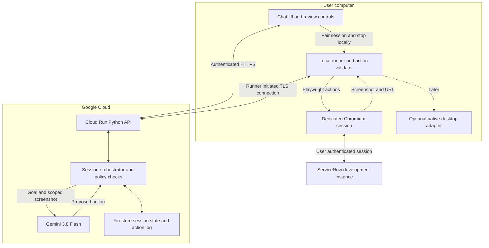

# ServiceNow computer use assistant

Hackathon product and technical proposal · October 26, 2026 · Draft for engineering and product

Build a chat assistant that can see an application, explain what is happening, and carry out a user's instructions by navigating, clicking, and typing. Start with ServiceNow: help service desk staff understand requests, prepare updates, and submit a selected catalog request without manually navigating every form.

**Recommended first build:** a visible, dedicated Chromium browser on the user's computer, controlled by a small local runner; a Python backend on GCP; and **Gemini 3.8 Flash** for computer use. Add control of native desktop apps through a separate adapter after the ServiceNow workflow works. Evaluate **Gemini 4 Argon** for difficult tasks. This is a proposed architecture, not an implemented or benchmarked system.

## Product idea and audience

The user gives an outcome in ordinary language: “Open this request, tell me what is missing, and prepare a work note.” The assistant shows its progress beside the application, asks for missing business information, and presents the proposed change before saving it. The user can pause, take over, or stop at any time.

The initial audience is service desk analysts and fulfillment staff who repeatedly search records, read activity histories, populate fields, and route work. A secondary audience is employees submitting requests through a service catalog. Product should choose one audience for the demo because their permissions, screens, and definitions of success differ.

The hypothesis is that a visible assistant can reduce navigation and repetitive data entry, especially across customized forms or multiple applications. Validate that hypothesis against manual completion and existing ServiceNow automation; a generic chatbot alone is not the differentiator. The differentiator we propose is completing a bounded workflow in the interface the user already uses, with a reviewable result.

### Capabilities and release scope

| Capability | Hackathon scope | Later extension |
| --- | --- | --- |
| Chat about the current screen | Explain the selected ServiceNow browser page | Explain a user-selected desktop window |
| Launch browsers and navigate | Start a dedicated browser/profile, open tabs, search records | Hosted browser sessions and existing-browser integration |
| Read requests | Summarize one record and identify missing information | Queue summaries and cross-application context |
| Edit records | Prepare and save one approved work note or field change | More record types and workflow-specific policies |
| Create requests | Fill one selected catalog item and submit after review | More catalog items and attachments |
| Complete fulfillment | Only a specifically agreed demo task with observable evidence | Actual fulfillment across approved enterprise apps |
| React to incoming work | User pastes a record URL or selects a queued example | Authorized ServiceNow event integration |
| Control native apps | Architecture and permissions defined; optional stretch demo | Packaged macOS and Windows desktop adapters |

Do not claim that updating a ticket means the underlying work is complete. For example, requesting software, granting access, and recording that access was granted are different operations.

## ServiceNow concepts and proposed demo

In a catalog workflow, a **request (REQ)** tracks an order, a **requested item (RITM)** represents an ordered catalog item, and a **catalog task (SCTASK)** represents work needed to fulfill it. The exact task generation and approval flow depends on the instance and catalog configuration. ServiceNow's documentation illustrates this relationship and the fields available on catalog tasks. [Track a catalog request](https://www.servicenow.com/docs/r/it-service-management/procurement/t_TrackReqFromServiceCatalog.html), [View and edit a catalog task](https://www.servicenow.com/docs/r/it-service-management/procurement/t_ViewAndEditACatalogTask.html).

An incident is a different workflow; do not assume that “request” means an incident or apply incident resolution rules to catalog fulfillment. Product must identify the actual record type, UI, and allowed transitions.

**Proposed primary demo:** a service desk analyst opens an existing catalog task, asks the assistant to summarize it, then asks it to prepare a work note and an allowed assignment change. The assistant identifies the exact record, fills the fields, presents the change, saves after approval, and reloads the record to verify persistence. Work notes and customer-visible comments must be treated separately; confirm their visibility and notification behavior in the demo instance.

**Second demo, if time permits:** an employee describes one catalog request. The assistant asks for required missing details, fills the selected item, shows the submission summary, submits once, and returns the resulting record number and link. Use the catalog's normal submission flow rather than manually inserting related request records.

Use an authorized development instance and synthetic records. If instance access is unavailable, a clearly labeled mock portal can demonstrate the interaction loop, but it does not validate ServiceNow compatibility.

### Product worksheet

| Decision | Product owner input |
| --- | --- |
| Primary user and painful task | **TBD:** role, frequency, current steps, approximate time |
| Exact workflow | **TBD:** create request, update RITM, fulfill SCTASK, or another flow |
| Demo instance and UI | **TBD:** instance URL; portal, workspace, or classic UI; access owner |
| Example records | **TBD:** three synthetic examples, including one incomplete request |
| Required inputs | **TBD:** fields, catalog variables, permitted values, source of each value |
| Authorized edits | **TBD:** record types, fields, assignment groups, state transitions |
| Review policy | **TBD:** which writes need individual review; who may approve |
| Completion evidence | **TBD:** what proves fulfillment occurred beyond a status change |
| Existing alternatives | **TBD:** current ServiceNow automation and why this workflow remains painful |
| Success target | **TBD:** acceptable completion rate, time saved, and intervention count |

## What the existing systems teach us

The reusable mechanism is an **observe → decide → execute → verify** loop. A model proposes actions; application code owns the computer session and carries them out. Buying access to a model does not itself grant access to a user's desktop.

| Reference | Publicly documented behavior | Implication for our build |
| --- | --- | --- |
| OpenAI computer use API | The model returns ordered UI actions. An action handler executes them and sends back screenshots. The application must verify the result. | Keep the model, executor, and verification separate. A generated call is not proof an action ran. |
| Anthropic computer use API | Client tools provide screenshots and mouse/keyboard actions in an environment the application controls. Anthropic also documents a separate browser tool. | Browser automation and full desktop control can share an agent loop while using different executors. |
| Claude Code desktop | Can operate approved apps on the actual desktop. Its documented tool selection favors connectors and other specialized tools before broad screen control. | Use precise tools where available; make desktop permissions and session boundaries visible. |
| Google computer use | Gemini interprets screenshots and returns actions for an execution environment supplied by the developer. | We need a browser/desktop runner in addition to Gemini and a chat interface. |

Sources: [OpenAI computer use](https://developers.openai.com/api/docs/guides/tools-computer-use), [Anthropic computer use](https://platform.claude.com/docs/en/agents-and-tools/tool-use/computer-use-tool), [Claude Code desktop](https://code.claude.com/docs/en/desktop#let-claude-use-your-computer), [Gemini computer use](https://ai.google.dev/gemini-api/docs/computer-use).

This comparison uses public APIs and documented product behavior. It does not assume that ChatGPT's internal implementation is identical to OpenAI's API examples, or that a cloud browser and control of the user's physical desktop are interchangeable.

## Google model recommendation

| Model | Proposed role | Reason |
| --- | --- | --- |
| **Gemini 3.8 Flash** — `gemini-3.8-flash` | Default for the first prototype | Google explicitly recommends it for computer use. Start with one model for both conversation and action selection. |
| **Gemini 4 Argon** — `gemini-4-argon` | Evaluate on complex or failing workflows | Google identifies it as its most capable model; determine whether better completion justifies its measured latency and cost. |
| **Gemini 3.5 Flash-Lite** — `gemini-3.5-flash-lite` | Optional later efficiency experiment | Google lists it as a lower-latency, cost-effective computer-use option. Do not add routing complexity before measuring the primary model. |

The recommendation is based on documented suitability, not a ServiceNow benchmark. Both the [3.8 Flash GCP model page](https://docs.cloud.google.com/gemini-enterprise-agent-platform/models/gemini/3-8-flash) and the [4 Argon GCP model page](https://docs.cloud.google.com/gemini-enterprise-agent-platform/models/gemini/4-argon) list computer use as a **preview** capability. Google's [Gemini API computer-use guide](https://ai.google.dev/gemini-api/docs/computer-use#model-versions) supplies the model recommendation and alternatives.

For GCP, start with the **Google Gen AI Python SDK** and the GCP-documented `generate_content` computer-use path. The current [GCP computer-use guide](https://docs.cloud.google.com/gemini-enterprise-agent-platform/models/computer-use) documents Python and Playwright and carries a preview SDK limitation. The Gemini Developer API guide instead demonstrates the Interactions API with multiple SDK languages. Pin the SDK and validate one complete request/action/response cycle against our GCP project before building around a schema; do not mix examples from the two surfaces. The former Vertex AI documentation URLs currently redirect to Gemini Enterprise Agent Platform documentation.

The first technical checkpoint must confirm project billing, enabled service, model access, supported location, quota, and the exact SDK/API combination. None of those account-specific conditions has been tested here. Keep the model ID and location configurable. Desktop-environment support is documented, but the native adapter and its end-to-end behavior still require a separate prototype.

## Execution modes and recommendation

| Mode | Where actions happen | Benefits | Tradeoffs |
| --- | --- | --- | --- |
| **Dedicated local browser — recommended MVP** | Chromium launched by our local runner | Visible interaction; user can log in directly; works from the user's network | Requires a local process; only controls its own browser session |
| Hosted browser on GCP | Browser in an isolated worker/VM | Can run without the laptop; easier to isolate from personal apps | Needs remote viewing/takeover, remote login, and enterprise network access |
| Actual local desktop | Native helper captures windows and injects input | Reaches native apps and existing application sessions | OS permissions, focus races, display scaling, and much broader access |

The MVP will not attach to the user's personal browser profile. The user signs into the dedicated browser, and its cookies remain local. Playwright supports launching browsers and capturing page images, so browser screenshots can come from the browser itself without capturing the entire desktop. [Playwright browsers](https://playwright.dev/python/docs/browsers), [Playwright screenshots](https://playwright.dev/python/docs/screenshots).

A website's screen-sharing permission provides a media stream; it does not provide general mouse/keyboard control of other applications. Actual desktop control needs a local installed helper or an equivalent privileged integration. [Screen capture API](https://developer.mozilla.org/en-US/docs/Web/API/MediaDevices/getDisplayMedia).

## Proposed architecture

**Data flow:** the local runner sends the selected browser screenshot and URL to the GCP backend. The backend asks Gemini for the next action, checks it, and returns a structured command. The runner checks the command against local session permissions, executes it, and captures the resulting state. GCP supplies reasoning and coordination; it cannot reach into the laptop without the runner.

### Suggested stack

| Component | Choice for the prototype | Responsibility |
| --- | --- | --- |
| Chat interface | React + TypeScript, served with the backend | Conversation, screenshot preview, change summary, approve/pause/stop |
| Agent backend | Python + FastAPI on Cloud Run | Model calls, action policy, progress stream, session ownership |
| Model client | Google Gen AI Python SDK | GCP authentication and model-specific request/response adapter |
| Local runner | Python + Playwright + installed Chromium | Browser lifecycle, screenshot capture, bounded action execution |
| Persistence | Firestore | Session status, approved changes, action IDs, outcomes; not browser cookies |
| Identity | Google sign-in with server-validated identity; paired runner token | Bind user, runner, and task; reject commands from other sessions |
| GCP authentication | Attached service account in cloud; ADC during development | Avoid embedding cloud credentials in the UI or runner |
| Operations | Cloud Logging; Secret Manager only for required integration secrets | Redacted operational events and managed secret access |
| Desktop extension | Thin native helper, packaged with a desktop shell if needed | Window capture, OS input, permissions, local emergency stop |

The cloud authentication proposal follows [Google's application default credentials guidance](https://docs.cloud.google.com/gemini-enterprise-agent-platform/models/start/gcp-auth). Grant only the model invocation and application resource access needed by the backend; keep provisioning/deployment privileges separate. Verify exact IAM roles for the chosen GCP endpoint during setup rather than granting project Owner.

Use a runner-initiated connection so the laptop does not need a public inbound port. For a WebSocket implementation, reconnect deliberately and persist progress: Cloud Run WebSockets have request timeouts, and reconnects can reach another instance. A lost connection pauses execution; it must not replay a save. [Cloud Run WebSockets](https://docs.cloud.google.com/run/docs/triggering/websockets).

A hosted-browser version could move the runner to a Compute Engine VM with a display and authenticated remote viewer. That is a separate deployment option, not a requirement for the local demo. A local GPU, Kubernetes cluster, vector database, and multi-agent framework are unnecessary for the proposed first workflow.

## Action loop and correctness

1. **Establish scope.** Bind the task to one user, runner, browser session, ServiceNow instance, and permitted workflow. The user completes login/MFA while capture and model activity are paused.
2. **Observe.** Capture the current viewport, URL, dimensions, and observation ID. Keep viewport size and scaling consistent. Convert model coordinates using the selected API's documented coordinate system; do not assume they are screen pixels.
3. **Decide.** Send the goal, allowed operations, relevant history, and screenshot. Parse only recognized structured actions. Preserve the provider's required tool response identifiers and conversation state.
4. **Validate.** Check allowed origin, target session, action arguments, current observation, and any provider safety response. The model cannot grant itself new permissions.
5. **Review writes.** For the first workflow, gate every save, submit, external comment, assignment change, or state transition. Show the record ID and exact proposed fields/text. Bind approval to that proposal and invalidate it if the form or record changes.
6. **Execute.** Give each action a unique ID and expiry. The runner rejects duplicates, stale observations, unknown commands, and commands arriving after stop. Execute sequentially and check intermediate state rather than blindly continuing a batch across a commit.
7. **Verify.** Capture the result; after a write, reopen or reload the record and check the saved values. Return the record link and what changed. If persistence cannot be established, report an uncertain outcome and investigate before retrying.

For the bounded ServiceNow demo, use known form controls and DOM checks to enforce the save boundary and verify fields, alongside screenshot-driven navigation. Pure pixel reasoning cannot reliably identify every consequential action. Treat auto-saving fields as writes too. If the chosen UI cannot provide a dependable review boundary, leave the final commit to the human for that workflow.

**Proposed initial limits:** 40 action steps, a five-minute run budget, and at most two recovery attempts for the same failed interaction. These are tunable design defaults. On budget exhaustion, an unknown dialog, session expiry, or repeated unchanged screenshots, pause and explain what is blocking progress. Transport delivery cannot guarantee exactly-once ServiceNow writes; reconcile the application's state after a timeout instead of blindly re-submitting.

## Permissions and data boundaries

| Surface | Access needed | Proposed boundary |
| --- | --- | --- |
| Dedicated local browser | Launch browser process, store its profile, reach ServiceNow and GCP | Only the runner-owned browser; no OS-wide screen recording or Accessibility permission needed for this mode |
| macOS desktop viewing | Screen Recording / Screen & System Audio Recording permission for the capturing app | User-selected window where possible; visible capture indicator |
| macOS desktop input | Accessibility permission for the controlling helper | Explicit app allowlist and control toggle; OS permission itself is broader than our app policy |
| macOS scripting | Automation consent may be needed if using Apple Events | Optional implementation choice, not a baseline requirement |
| Windows desktop | Installed helper with capture and input capabilities in the logged-in session | Separate Windows prototype; no elevated-app or UAC automation in the demo |
| Files and clipboard | Only if the selected workflow needs an attachment or paste operation | User-selected files; no broad disk or clipboard harvesting |
| Camera/microphone | None for the text-chat demo | Request microphone access only if voice is added |
| ServiceNow | User account with access to the selected records and actions | Keep existing role/ACL restrictions; no admin account as the default |
| GCP | Backend model invocation plus narrowly scoped storage/logging permissions | Runtime identity separate from deployment identity |

Apple documents separate controls for [screen recording](https://support.apple.com/guide/mac-help/control-access-screen-system-audio-recording-mchld6aa7d23/mac) and [Accessibility access](https://support.apple.com/en-euro/guide/mac-help/mh43185/mac). Windows does not use the same permission model: for example, `SendInput` is constrained by process integrity levels. Validate capture consent and packaging against the selected Windows implementation. [Microsoft SendInput](https://learn.microsoft.com/en-us/windows/win32/api/winuser/nf-winuser-sendinput).

Screenshots and visible record text leave the laptop for model processing. Tell users this before capture starts. Use synthetic data for the hackathon; keep screenshots in memory by default, omit raw images and credentials from logs, and make any retained diagnostic images explicitly opt-in with a deletion policy. Local cookies staying local does not mean all ServiceNow data stays local. Real customer data requires an agreed region, retention policy, and provider data-handling review before use.

Ticket descriptions, comments, attachments, and webpages are untrusted input. They must never redefine the task, authorize a new destination, or request secrets. Enforce allowed domains and redirects in code, pause at login screens, and retain provider-required safety confirmations. Add a local stop control that works even if the backend is unavailable. For desktop mode, also pause when focus changes or the user takes over.

## ServiceNow integration path

Start with the UI so the demo directly demonstrates computer use. Keep room for a hybrid integration: authorized APIs can later handle precise reads, record verification, or standard updates, while computer use handles interfaces without a suitable integration. ServiceNow REST access still depends on authentication, ACLs, and table web-service settings. [ServiceNow REST APIs](https://www.servicenow.com/docs/r/api-reference/rest-api-explorer/c_RESTAPI.html).

For incoming requests, a later ServiceNow flow or outbound integration could send a record reference to an authenticated intake endpoint. An event should enqueue work, not grant permission to act on the laptop. Require an active paired session and the user's configured workflow authorization. Dedupe events and fetch the latest record before acting; an unattended queue requires a hosted runner or an awake authorized desktop session.

Avoid creating raw REQ/RITM/task rows through generic CRUD without understanding catalog workflows. Product and a ServiceNow owner should select the appropriate catalog submission or workflow API if that path is added.

## Build sequence and acceptance criteria

| Milestone | Deliverable | Exit condition |
| --- | --- | --- |
| 1. Feasibility | GCP model call plus local screenshot/action loop | One screenshot produces an action that runs and returns a new screenshot through the chosen GCP API |
| 2. Read-only vertical slice | Chat, paired browser, request summary | Correct record found; summary matches its visible contents; stop works |
| 3. Controlled update | One supported edit, review gate, verification | Exact approved change persists on the correct record; rejection produces no write |
| 4. Demo hardening | Recovery, expired login, duplicate prevention, audit events | No blind replay after disconnect; unsupported cases pause cleanly |
| 5. Stretch | Catalog creation or one native app | Add only after the primary workflow passes repeated runs |

Run the chosen model on at least ten resettable synthetic cases: ordinary update, missing required field, ambiguous person, wrong record, delayed page, expired login, rejected approval, disconnect after save, malicious instructions in a ticket, and changed page layout. Confirm final state independently through a reload, an authorized read API, or a human inspection.

Measure task completion, field accuracy, elapsed time, model calls/tokens, interventions, duplicate writes, and cost per successful task. Compare 3.8 Flash and 4 Argon on the same cases before declaring a winner. A proposed demo threshold is at least 8/10 correct completions, with zero unauthorized or duplicate writes; exceptions must stop visibly. This is a target, not a measured result.

Estimate operating cost as model input/output usage across all turns, plus backend runtime, storage, and any hosted browser runtime. Screenshot size, repeated history, retries, and thinking effort affect the result. Record actual usage from test runs and consult the selected model's linked pricing page before setting a budget; no dollar estimate is asserted here. Enforce application run/step limits in addition to cloud budget alerts.

The immediate dependencies are a GCP project with model access, an authorized ServiceNow demo instance, one product-approved workflow, and a target demo OS. Once those are resolved, the first implementation should prove a single request can be read, changed with review, and verified end to end.
