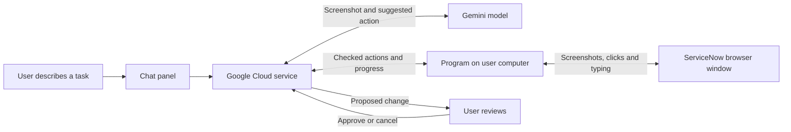

# ServiceNow computer use assistant

Hackathon proposal · October 26, 2026 · Draft for product and engineering

## The idea in one minute

Build an assistant that you can chat with while it works in an app for you. It can look at the screen, explain what it sees, click buttons, and fill out forms.

Our first use case is **helping people handle ServiceNow requests**. Instead of finding a request, reading its history, and updating several fields by hand, a user could say:

> “Open this request, tell me what is missing, and prepare an update.”

The assistant does the navigation and prepares the change. The user reviews it before it is saved and can take over at any time.

**For the hackathon, start with one ServiceNow task in a separate browser window.** Use Google's Gemini models to understand the screen and Google Cloud Platform (GCP) to run the service behind the app. Add control of other desktop apps later.

This is a proposal. We have not built the app or tested its performance in ServiceNow yet.

## Who it is for and why it might help

Start with service desk staff: people who spend time finding requests, reading notes, entering information, and passing work to the right team.

Employees who submit requests are a possible second audience. For example, an employee could describe the software they need and let the assistant fill out the request form.

The benefit we want to test is simple: **less time navigating forms, with fewer missed details**. We should compare the assistant with the current manual process and any automation the team already uses.

Choose one audience for the first demo. An employee requesting something and a service desk worker handling it use different screens and have different permissions.

## What using it would look like

Here is the proposed first demo:

1. **Open a request.** The user gives the assistant a ServiceNow link and signs in if needed.
2. **Understand it.** The assistant explains what has been requested and points out missing information.
3. **Prepare an update.** The user asks it to add a work note or assign the task to an allowed team.
4. **Review the change.** The assistant shows the exact record and proposed update. The user can approve, edit, or cancel.
5. **Save and check.** After approval, the assistant saves the change, reopens the record, and checks that it worked.
6. **Show the result.** The user gets a short summary and a link to the updated record.

The user can pause or stop throughout. If the assistant is unsure, it asks for help rather than guessing.

Updating a ticket does not mean the actual work is finished. For example, writing “access granted” is only correct if someone or something really granted that access.

## What to build first

### First demo

- A chat panel beside a visible browser window.
- Open and summarize one ServiceNow task.
- Ask for missing details.
- Prepare one supported update, such as a work note or assignment change.
- Save after review and check the result.
- Pause, stop, and let the user take over.

### If there is time

Add one request-creation example: the user describes what they need, the assistant fills out a chosen request form, and the user reviews it before submission.

### Later

Support more request types, attachments, incoming request alerts, and work across other apps. Full desktop control belongs here too: it needs more permissions and more testing than controlling one browser.

Use a ServiceNow test environment with made-up records for the demo. If we cannot get access, a clearly labeled mock app can show the idea, but it will not prove that the assistant works in ServiceNow.

## A quick ServiceNow guide

A request can contain several items, and each item can involve several tasks. For example:

| Term | Plain meaning | Example |
| --- | --- | --- |
| Request — REQ | The overall order | “Set up equipment for a new employee” |
| Requested item — RITM | One thing in the order | “Provide a laptop” |
| Catalog task — SCTASK | Work needed to deliver an item | “Prepare the laptop” |

The exact steps and approvals depend on how the company has set up ServiceNow. An incident is another type of work, so we should not treat every ticket as the same kind of request. [ServiceNow request guide](https://www.servicenow.com/docs/r/it-service-management/procurement/t_TrackReqFromServiceCatalog.html), [Catalog task guide](https://www.servicenow.com/docs/r/it-service-management/procurement/t_ViewAndEditACatalogTask.html).

For the first demo, we suggest updating an existing catalog task. Product and a ServiceNow owner should confirm that choice. They should also explain which notes are internal, which comments users can see, and which changes send notifications.

## Questions for the product person

Fill in these answers before we build the ServiceNow-specific parts.

| Question | Answer |
| --- | --- |
| Who is the first user? | **To fill in:** role and team |
| What task is most painful today? | **To fill in:** current steps, how often it happens, and time spent |
| Which task should the demo complete? | **To fill in:** one specific example |
| Which ServiceNow screen does the user use? | **To fill in:** test environment link and someone who can provide access |
| What information does the assistant need? | **To fill in:** required fields and where the answers come from |
| What may it change? | **To fill in:** notes, assignments, status, or other fields |
| What needs a person's approval? | **To fill in:** changes and who may approve them |
| What proves the task is done? | **To fill in:** the result we should be able to check |
| What tools already help with this? | **To fill in:** existing automation and what it misses |
| What examples can we test? | **To fill in:** three made-up requests, including one with missing information |

## How we will know it is useful

Measure whether the assistant completes the task correctly, how long it takes, and how often a person has to help. Compare those results with doing the same task manually.

A proposed demo goal is **at least 8 correct results out of 10 test cases, with no unapproved or duplicate changes**. This is a starting target, not a result we have achieved.

Include difficult cases: missing details, the wrong record, an expired login, a slow page, a rejected change, and a connection dropping just after a save. A clear request for help is better than a false “done.”

## How it works at a high level

The app has three main parts:

| Part | What it does |
| --- | --- |
| Chat panel | Lets the user describe the task, see progress, and review changes |
| Small program on the user's computer | Opens the browser, takes screenshots, and carries out allowed clicks and typing |
| Service running on Google Cloud | Sends the task and screenshots to Gemini and checks the actions it suggests |

The AI does not get direct access to the computer on its own. Our program carries out its suggested actions.

The process repeats: **look at the page → choose a step → check it → act → look again**. Before saving a change, the app asks for the user's review. After saving, it checks the result.

### Why start with a separate browser?

The user can watch the work and sign in directly. The assistant controls only the browser it opened, which keeps the first version focused. It does not need access to every window on the computer.

Later, we can add either a browser running in the cloud, which could work while the laptop is off, or control of desktop apps on the laptop. Those are different features with different setup needs.

### What users need to allow

For the first demo, users need to run our local program, sign into ServiceNow, and allow the selected page to be sent to Google for AI processing. Their ServiceNow account still determines what they can view and change.

For full desktop control later, the app will also need permission to see the screen and control other apps. On a Mac, those are separate system permissions.

**Screenshots and visible request text leave the laptop.** Explain this before the assistant starts. Use made-up data for the hackathon, pause capture during login, and keep passwords out of the chat and logs.

---

## Engineering details

The sections below explain the proposed tools, permissions, and checks needed to build the product described above.

### Google model choice

Start with **Gemini 3.8 Flash** for both chat and choosing browser actions. Google's computer-use guide recommends it for this purpose. Compare it with **Gemini 4 Argon** if it struggles with the chosen tasks. Consider **Gemini 3.5 Flash-Lite** later if reducing cost and response time becomes a priority. [Google's model recommendations](https://ai.google.dev/gemini-api/docs/computer-use#model-versions).

| Model ID | Proposed use |
| --- | --- |
| `gemini-3.8-flash` | First model to build and test with |
| `gemini-4-argon` | Compare on difficult tasks |
| `gemini-3.5-flash-lite` | Possible later cost and speed experiment |

The GCP pages for [3.8 Flash](https://docs.cloud.google.com/gemini-enterprise-agent-platform/models/gemini/3-8-flash) and [4 Argon](https://docs.cloud.google.com/gemini-enterprise-agent-platform/models/gemini/4-argon) list computer use as a **preview feature**. We have not measured either model on ServiceNow.

Use the **Google Gen AI Python SDK**—Google's library for calling its models—and begin with GCP's documented `generate_content` path. The [GCP computer-use guide](https://docs.cloud.google.com/gemini-enterprise-agent-platform/models/computer-use) describes Python and Playwright and notes preview SDK limits. The [Gemini Developer API guide](https://ai.google.dev/gemini-api/docs/computer-use) shows a different API path called Interactions. Keep examples from those paths separate, pin the library version, and test a complete action cycle before building further.

Before implementation, confirm billing, enabled services, model access, location, usage limits, and the library version in our GCP project. These account-specific checks are still outstanding. Keep model and location settings easy to change. Older Vertex AI documentation links now redirect to Gemini Enterprise Agent Platform documentation.

### What we can learn from OpenAI and Claude

| Reference | What its public documentation shows | What we should borrow |
| --- | --- | --- |
| OpenAI computer use API | The model suggests actions; application code runs them and returns screenshots | Separate suggested actions from actual execution and checking the result |
| Anthropic computer use API | The application provides screen capture and mouse/keyboard tools; browser tools are also available | Use the right tool for browser work versus desktop work |
| Claude Code desktop | Can work in approved apps and favors more specific tools when available | Make app access clear and use direct integrations where they fit |
| Google computer use | Gemini reads screenshots and suggests actions that our code must execute | Build a local helper as well as a chat interface |

Sources: [OpenAI computer use](https://developers.openai.com/api/docs/guides/tools-computer-use), [Anthropic computer use](https://platform.claude.com/docs/en/agents-and-tools/tool-use/computer-use-tool), [Claude Code desktop](https://code.claude.com/docs/en/desktop#let-claude-use-your-computer), [Google computer use](https://ai.google.dev/gemini-api/docs/computer-use).

These are public design references. They do not establish exactly how ChatGPT works internally, or mean that a browser in the cloud can control the user's physical desktop.

### Proposed tools

| Component | Tool | Job |
| --- | --- | --- |
| Chat interface | React + TypeScript | Chat, progress, change review, and stop controls |
| Cloud service | Python + FastAPI on Cloud Run | Call Gemini, check actions, and track each task |
| Model connection | Google Gen AI Python SDK | Send requests and read model responses |
| Local helper | Python + Playwright + Chromium | Open a browser, capture the page, click, and type |
| Saved task information | Firestore | Store task status, approvals, action IDs, and results |
| User identity | Google sign-in and a token that pairs the helper with the user | Prevent one user's commands from reaching another user's computer |
| Cloud access | Service account in GCP; application default credentials during development | Keep cloud credentials out of the browser and local helper |
| Support tools | Cloud Logging; Secret Manager if needed | Record useful errors and protect integration secrets |

Playwright can launch a browser and capture its page directly. That lets the first version avoid whole-desktop capture. Use a separate browser profile, let the user sign in, and keep its cookies on their computer. [Browser setup](https://playwright.dev/python/docs/browsers), [Page screenshots](https://playwright.dev/python/docs/screenshots).

The local helper should open an encrypted connection to GCP; the laptop should not need a public incoming port. Pair each connection with a user and task. If using WebSockets, support reconnecting and save progress outside the Cloud Run process: connections time out and may reconnect to a different server. Pause after a disconnect and check what happened before resuming. [Cloud Run WebSockets](https://docs.cloud.google.com/run/docs/triggering/websockets).

Give the GCP service only the permissions it needs to call models and use the app's storage and logs. Keep deployment permissions separate. Check the exact roles during setup. [Google authentication guidance](https://docs.cloud.google.com/gemini-enterprise-agent-platform/models/start/gcp-auth).

No local GPU or large infrastructure setup is needed for this first design. A later cloud-browser version could run the helper on a Compute Engine virtual machine, but would also need secure remote viewing, login, and access to the company's network.

### How to execute actions safely and check them

1. **Set the task limits.** Tie the task to one user, browser, ServiceNow environment, and allowed set of changes. Pause model activity and capture while the user logs in or completes a second login check such as MFA.
2. **Capture the current page.** Include its URL, image size, and a unique observation ID. Keep display size stable and convert model coordinates using the selected API's rules.
3. **Ask for the next step.** Send the goal, relevant history, screenshot, and permitted actions. Preserve the model API's required conversation and tool-response identifiers.
4. **Check the proposed action.** Reject unknown commands, disallowed websites, old screenshots, and actions for another session. Honor any confirmation required by the model provider.
5. **Get review before changes.** Show the exact record, fields, and text before a save or submission. Approval applies only to that change. If the form changes, ask for review again.
6. **Execute one step at a time.** Give actions unique IDs and expiry times. Reject duplicates and commands received after stop. Check intermediate results before continuing.
7. **Check the saved result.** Reload the record and compare its values with the approved change. If a save may have succeeded before a connection failure, inspect the record before trying again.

For the chosen ServiceNow form, use checks against the page's underlying elements—the DOM—to identify save controls and verify field values. Screenshot interpretation alone cannot reliably spot every action that changes data. Fields that save automatically also need review before editing. If we cannot reliably enforce that boundary, the human should perform the final save.

Suggested starting limits are 40 actions, five minutes per task, and two attempts to recover from the same problem. Pause on an unfamiliar dialog, expired login, repeated lack of progress, or a reached limit. Adjust these limits after testing.

### Computer permissions

| Feature | Access needed | Limit for our app |
| --- | --- | --- |
| Separate browser | Start Chromium, store its profile, connect to ServiceNow and GCP | Control only the browser we launched; no OS-wide capture or Accessibility permission for this mode |
| View Mac desktop apps | Screen Recording / Screen & System Audio Recording permission | Capture a selected window where possible and show when capture is active |
| Control Mac desktop apps | Accessibility permission | Allow only selected apps; the OS permission itself is broader |
| Script Mac apps | Automation consent if using Apple Events | Only needed if we choose that implementation |
| Windows desktop control | Installed helper with screen capture and input support | Test separately; exclude administrator prompts and elevated apps from the demo |
| Files and clipboard | Access only when a supported task needs it | User-selected files; no broad collection of files or clipboard content |
| Camera or microphone | None for text chat | Ask for microphone permission only if voice is added |
| ServiceNow records | The user's existing record and field permissions | Do not use an administrator account by default |

Apple documents separate controls for [screen recording](https://support.apple.com/guide/mac-help/control-access-screen-system-audio-recording-mchld6aa7d23/mac) and [Accessibility](https://support.apple.com/en-euro/guide/mac-help/mh43185/mac). Windows uses different rules; for example, its `SendInput` function cannot freely control processes with higher privileges. [Microsoft input documentation](https://learn.microsoft.com/en-us/windows/win32/api/winuser/nf-winuser-sendinput).

Screen sharing in a website only provides images of the selected screen. It does not grant control of other apps. Full desktop control needs an installed helper or equivalent privileged integration. [Screen capture API](https://developer.mozilla.org/en-US/docs/Web/API/MediaDevices/getDisplayMedia).

### Data handling and stop controls

Keep screenshots in memory by default. Do not put passwords or raw screenshots in routine logs. If someone chooses to save images for debugging, define who can see them and when they will be deleted. Before using real customer data, agree on the processing region, retention period, and provider data-handling rules.

Text inside a ticket or webpage is task data, not permission to do new things. A malicious note could tell the assistant to reveal secrets or visit another site. Enforce allowed websites and actions in code rather than relying only on the model to ignore it.

Provide a local stop button that works without the cloud connection. For desktop control, also pause when the user takes over or the active app changes unexpectedly.

### Adding ServiceNow integrations later

Start with browser interaction for the demo. Later, a direct ServiceNow API connection could make reading records, checking saved changes, or making standard updates more reliable. An API is a way for software to exchange data directly. It still requires the right account access, record permissions, and ServiceNow settings. [ServiceNow REST APIs](https://www.servicenow.com/docs/r/api-reference/rest-api-explorer/c_RESTAPI.html).

An incoming-request alert could add a task to the app's queue. It should not automatically authorize control of someone's laptop. Check that a permitted session is active, ignore repeated alerts, and read the latest record before acting. Work while the laptop is off would require a cloud-based helper.

For request creation, use the normal catalog submission flow or an appropriate ServiceNow API. Do not create related request, item, and task records directly without understanding the approval and delivery process.

### Build order and testing

| Step | Build | Check before moving on |
| --- | --- | --- |
| 1 | One screenshot-to-action cycle through GCP | Gemini suggests an action, the browser executes it, and a new screenshot returns |
| 2 | Chat and request summary | Correct record found, accurate summary, working stop control |
| 3 | One reviewed update | Only the approved change is saved on the correct record |
| 4 | Error handling | Login expiry, rejected changes, slow pages, and disconnects pause or recover correctly |
| 5 | Optional second demo | Request creation or one desktop app, after the first flow works repeatedly |

Test both candidate models on the same examples before deciding whether to switch. Alongside the product measures above, record model calls, token usage, cost, and duplicate changes. Include a misleading instruction inside a ticket and a changed page layout. Check results independently through a reload, an authorized read API, or human inspection.

Cost will come from model usage, the cloud service, storage, and any browser hosted in the cloud. Screenshots, repeated history, retries, and model reasoning effort affect usage. Measure real test runs and use the selected model's pricing page before estimating a budget. Set application limits as well as cloud budget alerts.

**Needed to start:** a GCP project with model access, a ServiceNow test environment, one agreed task, and a chosen demo operating system.
